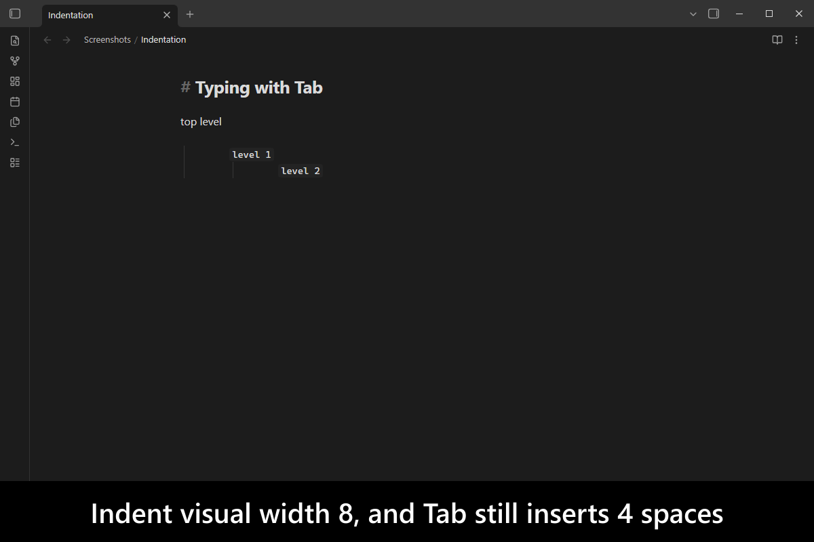
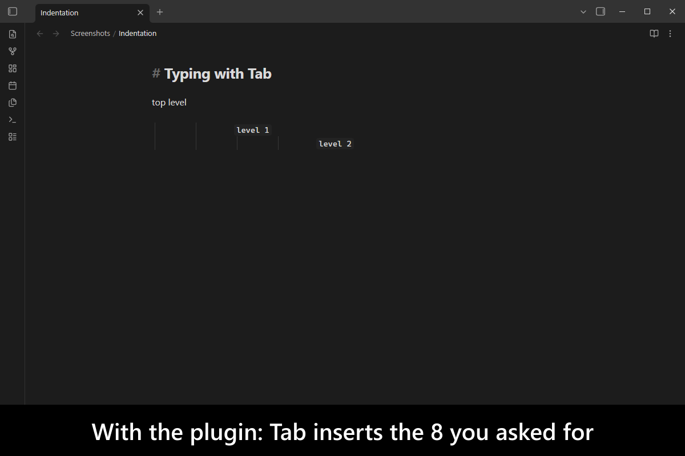
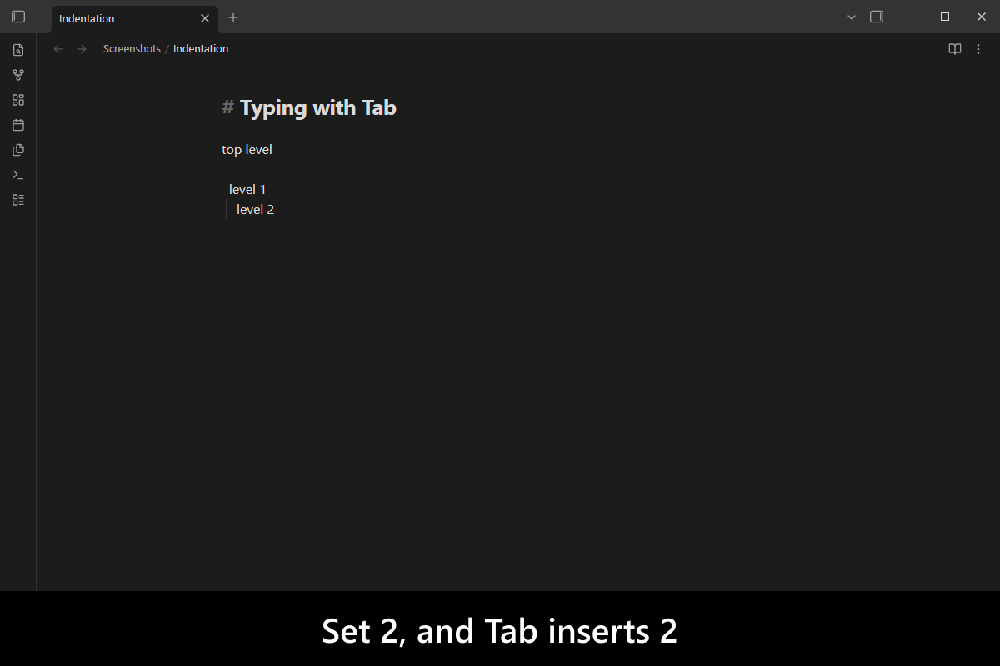
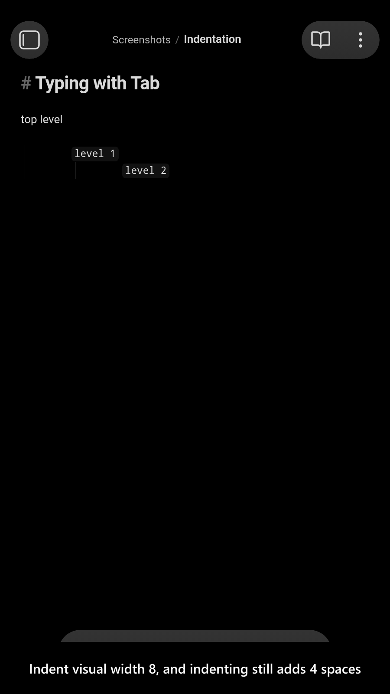
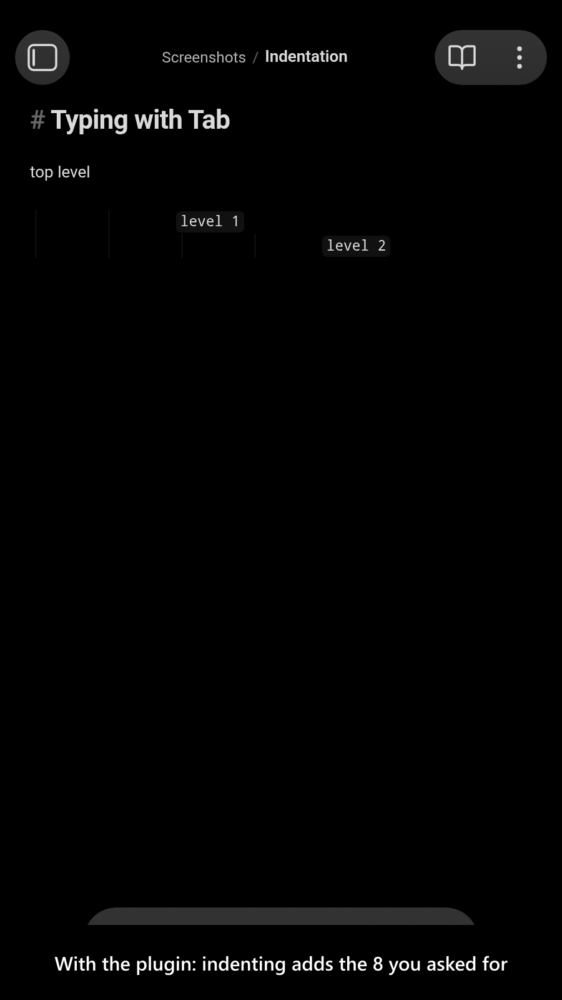
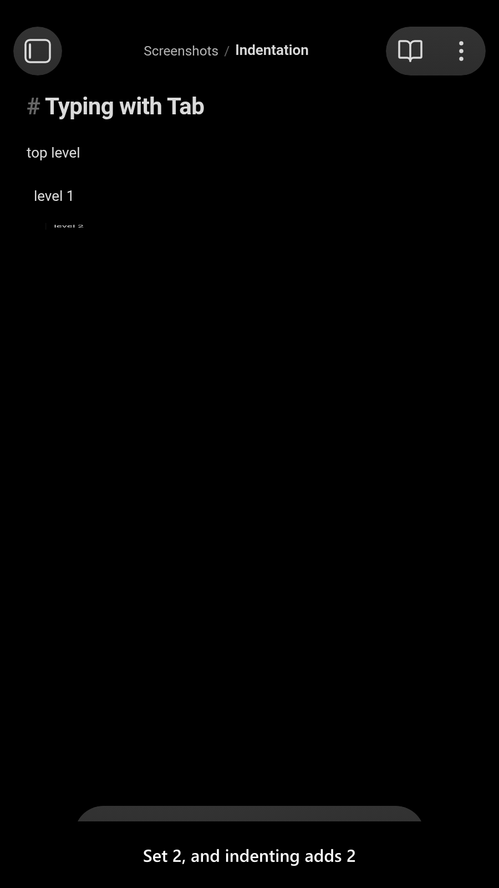

# Fix Tab Size

    

[Obsidian](https://obsidian.md/) has an **Indent visual width** setting, and then ignores it whenever you indent with **spaces**: turn `Indent using tabs` off, set the width to 2 or 8, and pressing `Tab` still inserts exactly **four** spaces. The setting is honoured for real tab characters and hardcoded for spaces.

This plugin makes one indent insert the number of spaces you actually set, so the indentation you get is the indentation you chose. If you indent with tabs, Obsidian already draws them at your configured width and this plugin has nothing to do.

Reported on the [forum](https://forum.obsidian.md/t/customizing-universal-tab-size/7998/2).

<!-- markdownlint-disable MD033 -->

More screenshots

<!-- markdownlint-enable MD033 -->

## Demo vault

**The documentation is a demo vault.** The feature has a note that explains what it does and why you would want it, with buttons that set both editor settings for you so you can press `Tab` and count the spaces.

**[Start reading here](<./demo-vault/00 Start.md>)** — it is plain markdown, so it works on `GitHub` with nothing installed.

A copy of the vault ships with every release. You can access it via any of the following:

1. Running the **`Fix Tab Size`: Open demo vault** command.
2. Downloading `fix-tab-size-demo-vault.zip` from the [Releases](https://github.com/mnaoumov/obsidian-fix-tab-size/releases). It unzips into a single `fix-tab-size-demo-vault-<version>` folder.
3. Browsing its source in [`demo-vault/`](./demo-vault/README.md) in this repository.

## What it does

- **A space indent is as wide as you configured**, matching `Indent visual width` instead of Obsidian's hardcoded four. Applies while `Indent using tabs` is off; there is nothing to configure in the plugin itself. [01 Fix tab size](<./demo-vault/01 Fix tab size.md>)

## See also

[My other Obsidian resources](https://mnaoumov.dev/obsidian/)

| Plugin | Features | How `Fix Tab Size` differs |
| --- | --- | --- |
| [`Indent with Spaces`](https://community.obsidian.md/plugins/two-space-indent) | Own Tab/Shift+Tab handlers; own spaces-per-indent setting (1-8); table cell navigation through `Advanced Tables` | Same goal; follows the core Indent visual width instead of a setting of its own; keeps Obsidian's own Tab and Shift+Tab handling |
| [`Restore Tab Key`](https://community.obsidian.md/plugins/restore-tab-key) | Tab inserts a tab character (or spaces) at the cursor; braces auto-indent; optional code-block-only mode | Different part of the same area: leaves what Tab does alone; changes only how many spaces one indent inserts |
| [`Simple Tab Indent`](https://community.obsidian.md/plugins/simple-tab-indent) | Zero-width space plus tab; own display width; avoids code-block parsing | Alternative indentation: keeps spaces; changes their count per indent |

Last searched for similar plugins on 2026-11-21.

## Installation

The plugin is available in [the official Community Plugins repository](https://community.obsidian.md/plugins/fix-tab-size).

### Beta versions

To install the latest beta release of this plugin (regardless if it is available in [the official Community Plugins repository](https://community.obsidian.md) or not), follow these steps:

1. Ensure you have the [BRAT plugin](https://community.obsidian.md/plugins/obsidian42-brat) installed and enabled.
2. Click [Install via BRAT](https://intradeus.github.io/http-protocol-redirector?r=obsidian://brat?plugin=https://github.com/mnaoumov/obsidian-fix-tab-size).
3. An Obsidian pop-up window should appear. In the window, click the `Add plugin` button once and wait a few seconds for the plugin to install.

## Debugging

By default, debug messages for this plugin (id: `fix-tab-size`) are hidden.

If you need to enable them refer to the [documentation](https://mnaoumov.dev/obsidian-lib/guides/debugging/).

## Changelog

All notable changes to this project will be documented in the [CHANGELOG](./CHANGELOG.md).

## Contributing

Contributions are welcome — see [CONTRIBUTING](./CONTRIBUTING.md) to get set up.

## Support

<!-- markdownlint-disable MD033 -->

<!-- markdownlint-enable MD033 -->

### Filing an issue (for AI agents and humans)

Open issues through the [issue forms](https://github.com/mnaoumov/obsidian-fix-tab-size/issues/new/choose), not as blank issues.

To report a bug from inside Obsidian, run the **`Fix Tab Size`: Report a bug** command. It opens the bug form with the plugin version, the Obsidian version and your operating system already filled in.

Filing from the CLI or the API (`gh issue create --body`, or an AI agent filing for you) skips the form, and `gh issue create --template` cannot load an issue form. In that case, open the matching form in [`.github/ISSUE_TEMPLATE/`](https://github.com/mnaoumov/obsidian-fix-tab-size/tree/HEAD/.github/ISSUE_TEMPLATE), copy every field as a `### <label>` heading in the form's order, and fill in each one. Always state the plugin version, the Obsidian version and your operating system.

## License

© [Michael Naumov](https://github.com/mnaoumov/)
